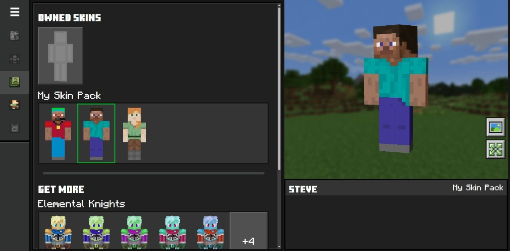

# Minecraft Dressing Room



This project brings the Minecraft Bedrock Dressing Room experience directly into the web browser, allowing players to preview, customize, and try on skins and emotes before purchasing them on the [minecraft.net](https://www.minecraft.net/en-us/marketplace/category/skin-packs) Marketplace.

---

## Features

### 3D Character Preview & Interaction
- **Real-time 3D Rendering:** High-fidelity character rendering powered by Three.js and React Three Fiber.
- **Interactive Controls:** Click and drag to smoothly rotate the character 360 degrees.
- **Head Tracking:** The character's head naturally follows pointer movement across the screen.
- **Expandable Stage:** Toggle between a side-by-side catalog view and a full-width expanded character view.
- **Environment Backdrops:** Cycle through authentic Minecraft backgrounds (Overworld, Sift, Cave, Nether, End, and Dark Grid) with blurred backdrop layers that keep character focus sharp.

### Skin Packs & Customization
- **Classic & Slim Geometries:** Seamless support for both Steve (4-pixel arm) and Alex (3-pixel arm) body layouts.
- **Skin Pack Catalog:** Browse owned and available skin packs with lazy-loaded, hover-animated 3D tile previews.
- **Custom Skin Import:** Upload custom PNG skins (64×32 legacy, 64×64 modern, and 128×128 HD) with automatic UV remapping and texture normalization.
- **Client-Side `.mcpack` Parser:** Built-in extraction and parsing of `.mcpack` and `.zip` archives, validating manifests, skins metadata, and localized language files.

### Emotes & Animations
- **Interactive Emotes:** Play animations like Jump, Wave, Clap, Spin Jump, and Head Spin.
- **Dynamic Camera Framing:** Automatically adjusts camera distance and framing during dynamic emotes (such as high jumps) to keep the character in view.
- **Pose Blending:** Smooth transitions between resting, mouse-tracked poses and skeletal animation clips.

### Marketplace Integration
- **Marketplace Hub:** A dedicated marketplace showcase page featuring product details, ratings, Minecoin pricing, and hero art.
- **"Try It On" Flow:** One-click transition from the marketplace listing into the dressing room with the pack preselected.
- **Return Navigation:** Context-aware navigation controls allowing users to return directly to the marketplace or explore all packs in the catalog.

---

## Architecture & Technical Details

```
src/
├── features/characters/
│   ├── animations/     # Animation manager, clips library, and camera framing
│   ├── components/     # React 3D preview canvas, skin tiles, and emote tiles
│   ├── models/         # Character factory and GLTF model loaders
│   ├── previews/       # Shared offscreen WebGL thumbnail renderer and head tracking
│   ├── skins/          # Skin catalog, UV normalizer, pack parser, and pricing
│   └── runtime.ts      # Core studio engine lifecycle and state
├── marketplace/        # Standalone marketplace showcase page and styles
├── styles/             # Faithful Bedrock UI SCSS styles and fonts
└── App.tsx             # Dressing room UI layout, navigation, and events
```

- **Shared Thumbnail Renderer:** Catalogs generate 3D preview frames using a single shared offscreen WebGL context (`ThumbnailRenderer`), avoiding browser WebGL context limits on large packs.
- **Texture Normalization:** The `SkinNormalizer` handles client-side canvas transformations, converting legacy single-layer 64×32 skins to dual-layer modern formats and converting between classic and slim models on the fly.
- **Lightweight State & URL Sync:** URL query parameters (`?pack=...&from=...`) keep state synchronized between the marketplace and dressing room while supporting native browser history (Back/Forward).
- **Multi-Page Vite Configuration:** Configured with multi-page Rollup entries for both `index.html` (Dressing Room) and `marketplace.html` (Marketplace) to deploy seamlessly on static hosts like GitHub Pages.

---

## Getting Started

### Prerequisites
- [Node.js](https://nodejs.org/) (version 18 or higher recommended)
- `npm`

### Installation
```bash
git clone https://github.com/jovanyoshioka/Dressing-Room.git
cd Dressing-Room
npm install
```

### Development
Start the local Vite development server:
```bash
npm run dev
```

### Production Build
Build both the dressing room and marketplace for production:
```bash
npm run build
```
The output will be generated in the `dist/` directory, ready to deploy.
